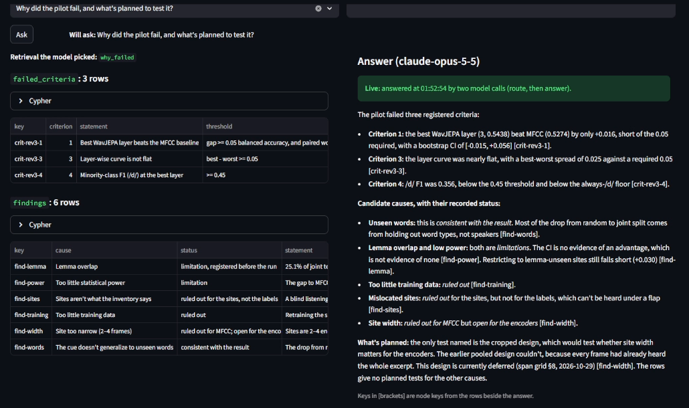

# PhonoProbe

**Do speech models hear through neutralization?** PhonoProbe compares what
self-supervised speech models represent about speech, on one hard case. It probes
frozen encoders (WavJEPA and wav2vec2-base, against an MFCC baseline) for the
underlying /t/ or /d/ in American English flaps from the Buckeye Corpus. It also
keeps the study itself in a knowledge graph that can be asked questions in plain
English.

Daniel Evans · M.S. Data Science, University of Missouri–Kansas City ·
CS 5588 Data Science Capstone, instructor Yugyung Lee

**[Demo video](https://youtu.be/m_TSUjhitwM)** · **[Poster (PDF)](docs/phonoprobe-poster.pdf)**

## The question

Neutralization is where the sound on the surface erases a contrast the language
keeps underneath. In American English, /t/ and /d/ between vowels often collapse
into the same quick flap, [ɾ], so *writer* and *rider* can sound alike. Do
self-supervised speech encoders keep the underlying /t/ or /d/, or only the sound
on the surface?

The same question applies well beyond English:

- **Final devoicing:** German *Rad* 'wheel' and *Rat* 'advice' are both [ʁaːt];
  Russian код 'code' and кот 'cat' are both [kot].
- **Inflection:** the accusative of кот is кота, but the accusative of код is код,
  the same as its nominative.

Can models recover phonological structure that neutralization hides? If so, they
could support comparative and historical linguistics, or help draft descriptive
grammars of under-documented languages.

## What was found

Results have different standing here, and each is labelled with its own: two
registered studies, then exploratory analyses that were not registered.

All of them work on flap sites from the Buckeye Corpus and ask whether a
representation separates underlying /t/ from /d/. The score is balanced accuracy
(chance 0.50) under the `joint` split, where no test speaker and no test word
form was seen in training. Predictions are out-of-fold, and intervals are 95%
from a 10,000-resample bootstrap over word types.

### The pilot: registered, failed 1 of 4

A linear probe on each of WavJEPA's 13 layers, read over the flap's own frames,
against MFCC features through the same probe. Registered before any probe was
trained: `experiments/pilot-flapping/README.md`. Report:
`results/flapping/criteria-20260926.txt`.

| Criterion, on `joint` | Needed | Got | |
|---|---|---|---|
| 1. Best layer beats MFCC | gap ≥ 0.05, interval's lower bound > 0 | layer 3 0.544, MFCC 0.527; gap +0.016 [−0.015, +0.056] | fail |
| 2. Control task shows no leak | within the null | p = 0.134 | pass |
| 3. Layer curve is not flat | best − worst ≥ 0.05 | 0.025 | fail |
| 4. /d/ F1 at the best layer | ≥ 0.45 | 0.356 | fail |

- **Most of the score was the word.** WavJEPA's best layer scores 0.652 under
  `random`, 0.627 with speakers held out, 0.559 with word forms held out and
  0.544 under `joint`. A word-identity lookup using no audio scores 0.94 on
  `random` and exactly 0.50 under `joint`.
- **This design did not find the information. It does not show the encoder
  lacks it.**
- **The sites hold up.** A blind listening audit of 80 sampled sites (40 /t/,
  40 /d/) found the transcribed word and a centred clip at all 80, and a flap at
  38 of 40 /t/ and all 34 judged /d/ sites (6 can't tell). Report:
  `results/flapping/audit-20260928.txt`.

### The span grid: registered, pooled design only

The follow-up asks where the cue sits, and adds wav2vec2-base. Registered before
any span was probed, in `experiments/span-grid/README.md`, with departures dated in
its §8.
It gates nothing, and it is the study's registered stopping point. Results:
`results/span-grid/`, on 10,334 sites (the pilot's 10,389 eligible sites less 55
registered exclusions).

Each site has four spans: **ɾ** (the flap), **Vɾ** (the preceding sonorant
stretch through the flap), **ɾV** (the flap through the following segment) and
**VɾV** (both). All frames come from one encoding of the flap ± 200 ms, pooled by
the mean over each span. So a difference between spans says where information
sits in the representation, not whether hearing more speech helps.

Balanced accuracy at each representation's best layer:

| Span | WavJEPA (layer) | wav2vec2-base (layer) | MFCC |
|---|---|---|---|
| ɾ | 0.543 [0.509, 0.577] (3) | 0.616 [0.582, 0.648] (9) | 0.529 [0.477, 0.582] |
| Vɾ | 0.555 [0.517, 0.592] (4) | 0.617 [0.577, 0.657] (9) | 0.530 [0.480, 0.579] |
| ɾV | 0.552 [0.519, 0.588] (4) | 0.622 [0.590, 0.656] (9) | 0.530 [0.481, 0.579] |
| VɾV | 0.551 [0.510, 0.592] (6) | 0.625 [0.588, 0.665] (9) | 0.544 [0.496, 0.592] |

An effect is called at a best-layer gap ≥ 0.05 with a paired 95% lower bound > 0.
By that rule:

- **C1, pooling over more of the neighbouring speech: no effect.** None of the
  nine gaps is called; the largest is +0.015 (MFCC, VɾV). The author's registered
  prediction that Vɾ beats ɾ is not supported.
- **C5, against MFCC: effect for wav2vec2-base, none for WavJEPA.** wav2vec2-base
  is ahead of MFCC on all four spans (+0.081 to +0.092) and of MFCC + duration on
  Vɾ and VɾV (+0.069, +0.079). WavJEPA's largest gap to MFCC is +0.025.
- **C4, against the stretch's duration: the same split.** wav2vec2-base is ahead
  on Vɾ and VɾV (+0.089, +0.098). WavJEPA is not (+0.028, +0.023).
- **C6, depth, read without a threshold.** wav2vec2-base peaks at layer 9 on every
  span. WavJEPA peaks at layers 3–6, with wide intervals. The pilot's
  prediction that WavJEPA's information sits higher is reversed.
- **C7, WavJEPA − wav2vec2-base: no effect, as registered.** The rule as written
  can only call a WavJEPA advantage, which was noticed after the results were
  read. Reported, not called: wav2vec2-base is ahead by 0.062 to 0.075, with every
  interval below zero. The encoders' order rests on C5.
- **Duration alone, reported and not compared, is near chance:** 0.527 clipped,
  0.529 unclipped, 0.524 for the vowel alone, each interval including 0.50.

Checks: the WavJEPA ɾ span was required to reproduce the pilot's `joint` curve
before anything else was read, and did. Every control-task p is above 0.05
(smallest 0.095). The lemma-unseen and unclipped re-scores stay within about 0.02
of the full scores, and all 5,650 fits converged. No multiple-comparison
correction is registered, and 29 gaps are called.

### Communities: exploratory, not registered

Louvain communities over the sites, with no probe trained. Read these as
comparisons, not as objects: the encoders' partitions change with the seed.
Aggregates: `kg/communities/representation/summary.json`,
`kg/communities/summary.json`.

- **Over each representation's ɾ-span features** (kNN graph, k = 15): WavJEPA
  layer 3's communities track speaker most (adjusted mutual information 0.234,
  against 0.126 for MFCC and 0.030 for wav2vec2-base layer 9). MFCC's track the
  phonetic environment most (vowel–following pair 0.160, against 0.089 and 0.043
  for wav2vec2-base and WavJEPA).
- **With /t/–/d/, all three barely line up** (wav2vec2-base 0.007, MFCC 0.007,
  WavJEPA 0.002). wav2vec2-base and MFCC are tied across seeds.
- **Word and environment can't be told apart in this data.** Each
  representation's score with word is close to its score with the pair.
- **Over a Site–Phone graph of the environments themselves:** 20 communities,
  with Cramér's V 0.299 with /t/–/d/, below the vowel–following pair's own 0.536.
  Resampling by word, 5 of the 20 have a /d/ share whose interval excludes the
  24.3% base rate.

## The app

A Streamlit app (`app/streamlit_app.py`) over the pilot run. It takes a reader
from the pre-registered result to the individual sites behind it, the audio of
each one, and a human judgement of that audio. Every answer carries its
provenance: the run, the code commit, and the denominator it has to be read
against. **The span grid and the communities have no tab of their own:** each
shows as one summary figure, and their detail is reachable through **Ask the
graph**.

The tabs follow the study's argument: the question, the result, why, the flaps
themselves, whether the data holds, questions to the graph, then how it was
built. Figures come in light and dark versions (`app/assets/figures/`), chosen
to match the viewer's theme. There is no sidebar: each tab has the controls it
uses (split, layer, pooling), starting at the registered design (`joint`, mean
pooling, that split's best layer), and the page shows the headline run. The
run's provenance (commits, inventory hash, seeds, split scheme) is in **Run
details**, at the foot of How it was built.



| Tab | What it shows |
|---|---|
| **The question** | *writer* and *rider* in American and British English (Kokoro-82M syntheses), each with its waveform and audio: why the /t/–/d/ difference is gone from the sound but kept in the word |
| **The result** | The four pre-registered criteria parsed from `results/flapping/criteria-20260926.txt`, the layer curves, and per-layer 95% intervals for a chosen split and pooling |
| **Listening, or recognizing the word?** | The drop from `random` to `word_disjoint` (the study's main reading), the sites whose prediction changed between two splits, and two follow-ups: the span grid and the representation communities |
| **Hear the flaps** | The sites matching a filter (split, layer, pooling, /t/ or /d/, right or wrong), each playable as the exact audio samples the encoder read |
| **Can the data be trusted?** | What the inventory left out, and the blind listening audit: its result, and the review form (a pre-registered random sample, judged by ear with nothing from the model on screen) |
| **Ask the graph** | A question about the study answered from its knowledge graph by `kg/graphrag.py` (route → retrieve → answer): the chosen retrieval, its Cypher and rows, then the answer citing node keys. Needs Neo4j and `ANTHROPIC_API_KEY`; without them only this tab says so |
| **How it was built** | The architecture diagram (data, probing, knowledge graph, app), with a paragraph per band |
| **Look up one site** | For checking the run: one site's state (scored, excluded before scoring, or not reached), never shown as a zero |

### The Human–AI workflow

**Human input → tools → result + evidence → human review.**

1. The human sees the pre-registered result first: *PILOT: FAILED, 1 of 4
   criteria pass*. Then they pick a split, a layer and filters in the tab
   that uses them.
2. Typed, tested tools (`capstone.retrieval.SliceStore`, DuckDB over parquet)
   return the matching sites. These tabs use no language model and have no
   free-form query path. Only **Ask the graph** calls a language model.
3. Every table comes with its denominators (shown / scored / eligible / in the
   corpus), and every site with its clip. The clip is planned through the same
   function the encoder used, so what you hear is what the model read.
4. The human reviews the **data** behind the result: is there a flap, is the word
   the one transcribed, is the clip centred? Doing this blind on a random sample,
   registered before listening (pilot pre-registration §7), makes the review a
   measurement rather than a widget. Verdicts recorded while browsing are kept but
   never counted.

Under the tabs, the app enforces provenance. Every response carries a coverage
block, and three eligibility states stay distinct. The run's own manifest decides
whether the synthetic-run warning shows, and a query that fails to pin one prediction per
site raises an error instead of double-counting.

### The knowledge graph behind Ask the graph

`kg/` holds the study in Neo4j: registrations, criteria, outcomes, findings and
what each rests on. `kg/graphrag.py` routes a question to one of seven reviewed
retrievals, so the language model chooses a query but never writes one. It then
answers from the returned rows, citing node keys. Details: `kg/README.md`.

Two course evaluations of it, neither a result about speech:

- **With and without the `communities` retrieval** (exploratory; answer keys fixed
  before the runs): 8 questions × 3 runs × 2 conditions, 48 runs. Summary:
  `kg/graphrag-runs/codesign-ablation/ablation-table.md`. With it, the two
  community questions scored correct in all 6 runs. Without it, the 6
  hand-checked runs of those questions were correct refusals, 4 of which the
  automatic scorer had marked wrong. The other six questions scored alike in both
  conditions. Daniel hand-checked 20 of the 48 runs, and the automatic score agreed
  with him on 14 of the 20.
- **A GNN evidence ranker** (`kg/gnn/`): at the course notebook's settings, no
  ranker gets the reviewed evidence into its top 5 (mean hits@5 / possible 0.10
  vector only, 0.00 graph expansion, 0.00 graph + GNN). That is five questions, so
  it is a pattern, not a result.

## How to run it

### Data

- **Buckeye Corpus** of conversational American English (Pitt et al., 2007), 40
  speakers. The inventory holds **10,392 flap sites (7,863 /t/, 2,529 /d/)**, built
  by `scripts/count_flap_sites.py` from the hand-corrected phone tier.
- **Nothing derived from Buckeye per site is in this repository.** OSU distributes
  the corpus only through a free registration, so the corpus, features and
  predictions live under `/data`, and the inventory, the lemma-overlap table and
  the audit sample are ignored (`.gitignore`). What is committed: the results CSVs,
  the criteria and audit reports, the figures, and run manifests with seeds and
  commits.
- **To rebuild from a registered copy:** register at
  [buckeyecorpus.osu.edu](https://buckeyecorpus.osu.edu), place the archives as
  `scripts/setup_buckeye.sh` describes and run it, then
  `scripts/count_flap_sites.py` regenerates the inventory.

### The app

It runs locally because Buckeye's license restricts redistributing its audio. It
needs no GPU and no CUDA image:

```bash
uv venv .venv-app && uv pip install --python .venv-app/bin/python -r requirements-app.txt
.venv-app/bin/streamlit run app/streamlit_app.py --server.address 0.0.0.0 --server.port 8501
.venv-app/bin/python -m pytest tests          # app-environment tests
```

**A fresh clone will not open the tabs.** The app stops at a list of what is
missing until it has:

- the inventory, `results/flapping/sites-20260924.parquet`, from
  `scripts/count_flap_sites.py --parquet` (git-ignored);
- the pilot's predictions and manifest, under
  `/data/embeddings/probe-run-20260926/`.

The audio tabs also need the corpus at `/data/corpora/buckeye`, and the audit needs
its git-ignored sample. Without any of these, the committed reports and figures can
still be read directly under `results/`.

After listening, `.venv-app/bin/python scripts/summarize_audit.py` writes the audit
report under `results/flapping/`.

### The container

```bash
docker compose run --rm dev                          # shell, GPU attached
docker compose run --rm dev python -m pytest --ignore=tests/test_ablation.py           # fast tests
docker compose run --rm dev python -m pytest -m model --ignore=tests/test_ablation.py  # checkpoint-dependent
```

`tests/test_ablation.py` imports `anthropic`, which only the app environment
installs, so it runs there and is excluded here.

Tests marked `model` need the encoder checkpoints and a GPU, so they are deselected
by default (`pyproject.toml`). Run them after any bump to `transformers` or a pinned
checkpoint revision: WavJEPA loads with `trust_remote_code=True`, so upstream can
change its frame arithmetic under already-cached embeddings, and those tests are
the tripwire.

The repo bind-mounts to `/workspace`, data to `/data`. Configs reference `/data` by
absolute path.

### The studies

These need a registered corpus copy. The docstrings hold the details.

```bash
# The pilot: the extraction itself runs in the container, the probes in .venv-app
.venv-app/bin/python scripts/extract_site_features.py export-sites
docker compose run --rm dev python scripts/extract_site_features.py extract
.venv-app/bin/python scripts/run_probes.py gate
.venv-app/bin/python scripts/run_probes.py rest
.venv-app/bin/python scripts/run_probes.py assemble
.venv-app/bin/python scripts/plot_layer_curves.py

# The span grid, pooled design
docker compose run --rm dev python scripts/extract_span_features.py
.venv-app/bin/python scripts/run_probes.py span-repro
.venv-app/bin/python scripts/run_probes.py span-grid
.venv-app/bin/python scripts/score_span_grid.py
```

### The knowledge graph

Full setup is in `kg/README.md`. Neo4j runs from `kg/compose.yaml`, and the API key
goes in `.env` at the repo root (git-ignored). Once loaded:

```bash
.venv-app/bin/python kg/graphrag.py "Why did the pilot fail, and what's planned to test it?"
.venv-app/bin/python kg/run_ablation.py score      # rescores the saved runs; no model call
```

### Cloud

Build and push the image, pull it on the instance (Lambda / Vast / RunPod), populate
`/data` (`scripts/download_common_voice.sh`; Buckeye by registration, then
`scripts/setup_buckeye.sh`), and run with `--gpus all` and `configs/cloud.yaml`.

## Limitations

### Of the results

- **The pooled design cannot settle width for the encoders.** Every span's frames
  had heard the whole excerpt, so pooling more of them changes which frames are
  read, not what was heard. For MFCC, whose frames are local, the span grid rules
  site width out as the pilot's problem. For the encoders it stays open.
- **The cropped design was not run.** It was deferred before any span was probed
  (span grid §8). C2 and C3 are untested, and C4, C5 and C7 are read
  for the pooled design only.
- **Two encoders, one checkpoint each.** wav2vec2-base's lead is a result about
  these two models. It cannot be attributed to the training objective. HuBERT and
  WavLM were never run.
- **Mean pooling discards duration.** The mean of a span's frames doesn't depend on
  how many there were, so an encoder carries a stretch's length only if its frames
  encode it themselves.
- **One kind of probe.** Every score is a linear probe's. A near-chance score says
  the cue wasn't linearly recoverable from those frames, not that it is absent.
- **"Unseen words" means unseen word forms.** The split is disjoint by form, not
  lemma. Under `joint`, **25.1% of the pilot's test sites** have their lemma in the
  probe's training set with the same label. Criterion 1 re-scored on the other 7,586
  sites does not pass either, and the span grid's re-score is reported beside each
  of its results.
- **Limited power.** MFCC's own interval under `joint` is about **±0.05** balanced
  accuracy, as wide as the effect the rule asks for. A real but small advantage
  would not be distinguishable.
- **The result covers words that kept their dictionary shape.** Each site's /t/ or
  /d/ comes from aligning the canonical and transcribed pronunciations sound by
  sound, which needs them to be the same length. 21% of flap-bearing words weren't
  (a sound dropped, added or merged) and were set aside rather than guessed at;
  flaps in those more reduced words would need a different alignment. In the span grid, 677 sites (6.55%) run past the excerpt and
  are clipped; they are kept, and also reported separately.
- **The audit clears the sites, not the labels, and it has one untrained listener.**
  It found no sign that the failure comes from badly cut or mislocated sites: the
  lowest Wilson lower bound is 0.835 (flap, /t/). But the underlying /t/ or /d/ comes
  from the word's dictionary form and cannot be heard under a flap, so the audit does
  not check it. Its rates bound what one ear agrees with, nothing more.
- **The app shows the pilot only,** and the two graph evaluations above are small
  course exercises.

### Registered but not run, and proposed

Nothing here has run and none of it is scheduled. The span grid is the registered
stopping point, and the pilot's §5 forbids adjusting that study and rerunning it.

- **Registered, deferred:** the span grid's cropped design. §3's specification and
  §6's predictions stand, and a later run would be read against them as written.
- **Proposed, each needing its own registration:** a lemma-disjoint split; a stronger
  probe; HuBERT and WavLM, for a layer-wise comparison across training objectives;
  ABX discrimination as a probe-free measure.

## Layout

| Path | What | Committed? |
|---|---|---|
| `Dockerfile`, `compose.yaml` | The environment. Same image locally and on cloud GPUs. | yes |
| `configs/` | `local.yaml` / `cloud.yaml` | yes |
| `src/capstone/` | Package: `encoders/` (WavJEPA and wav2vec 2.0), `probes/`, `splits`, `retrieval`, `audit`, `predictions`, `seeds`. `data/` and `alignment/` hold only an `__init__.py`. | yes |
| `scripts/` | Thin entrypoints (extract, probe, score, plot), plus `smoke_*` / `probe_*` diagnostics that establish facts about a checkpoint | yes |
| `experiments/` | The two registrations: `pilot-flapping/`, `span-grid/` | yes |
| `results/` | `flapping/`, `span-grid/`, `corpus-verification/`: promoted metrics, reports and figures, nothing per site | yes |
| `app/` | The Streamlit interface. Runs on `requirements-app.txt` alone: no GPU, no CUDA image. | yes |
| `kg/` | The knowledge graph, GraphRAG, communities, the ablation and the GNN | yes |
| `tests/` | Fast tests of frame geometry, splits, probes, retrieval, audit and the GraphRAG hand-over; `model` tests need a checkpoint | yes |
| `docs/` | `challenges/` (course briefs and decisions), `provenance/commit-map.txt` | yes |
| `stimuli/` | A README only: build instructions for self-recorded код/кот stimuli. No audio has been committed. | yes |
| `notebooks/` | Empty placeholder (`.gitkeep`) | yes |
| `ops/` | Git pre-commit hook | yes |
| `/data` (mount) | `corpora/`, `embeddings/`, `checkpoints/`, never inside the repo | no |

## References

**Dataset**
- Pitt, M. A., Dilley, L., Johnson, K., Kiesling, S., Raymond, W., Hume, E.,
  & Fosler-Lussier, E. (2007). *Buckeye Corpus of Conversational Speech*
  (2nd release). Department of Psychology, Ohio State University. Distributed
  under a license; not redistributed here.

**Papers**
- Pasad, A., Chou, J.-C., & Livescu, K. (2022). Layer-wise analysis of a
  self-supervised speech representation model. ASRU 2021;
  [arXiv:2107.04734](https://arxiv.org/abs/2107.04734). The layer-wise method
  this project applies to a JEPA encoder.
- Pasad, A., Shi, B., & Livescu, K. (2023). Comparative layer-wise analysis
  of self-supervised speech models. ICASSP 2023;
  [arXiv:2211.03929](https://arxiv.org/abs/2211.03929). The cross-model
  comparison behind this project's encoder comparison.
- Hewitt, J., & Liang, P. (2019). Designing and interpreting probes with
  control tasks. EMNLP 2019; [arXiv:1909.03368](https://arxiv.org/abs/1909.03368).
  The source of the control task. Under this design it becomes a leak check
  (pre-registration §5).
- Yuksel, Guetschel, Tangermann, van Gerven, & van der Heijden (2025). WavJEPA:
  Semantic learning unlocks robust audio foundation models for raw waveforms.
  [arXiv:2509.23238](https://arxiv.org/abs/2509.23238). The primary encoder.

**Code**
- [labhamlet/wavjepa](https://github.com/labhamlet/wavjepa): WavJEPA code and
  checkpoints.
- [s3prl/s3prl](https://github.com/s3prl/s3prl): a toolkit for self-supervised
  speech models and the SUPERB benchmark; a reference for loading
  encoders layer by layer.
- [ankitapasad/layerwise-analysis](https://github.com/ankitapasad/layerwise-analysis):
  code for the Pasad et al. layer-wise analyses.
- [zerospeech/libri-light-abx2](https://github.com/zerospeech/libri-light-abx2):
  ABX evaluation, the probe-free measure proposed under limitations; not run.

## This repository and its history

This is the public successor to a private working repository. Its history is
that repository's, rewritten with `git filter-repo` on 2026-10-16 to remove the
Buckeye download automation and every Buckeye-derived per-site file, and to
redact example site identifiers and word lists. Commit hashes therefore differ
from the private repository's: `docs/provenance/commit-map.txt` maps each
private commit to its public counterpart (an all-zero hash means the commit
touched only removed files). The private repository stays the record that the
pre-registration preceded the pilot; the course instructor is a collaborator
on it.

## License

MIT; see `LICENSE`. The Buckeye Corpus is not covered by it and is not
redistributed here.
